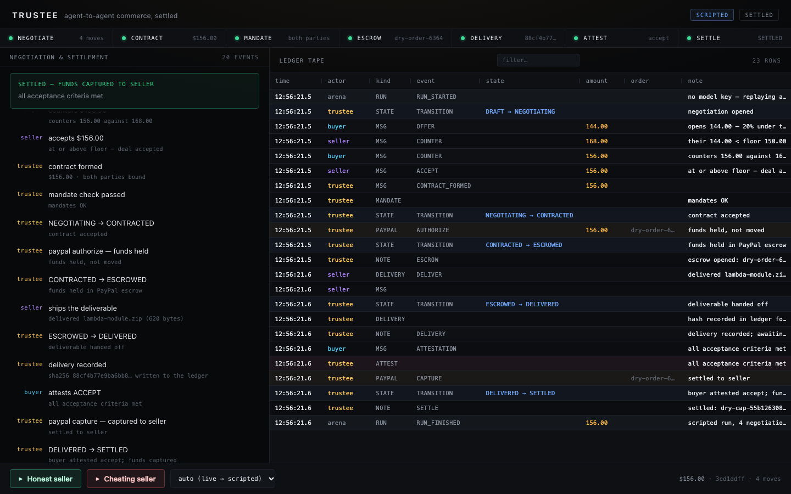
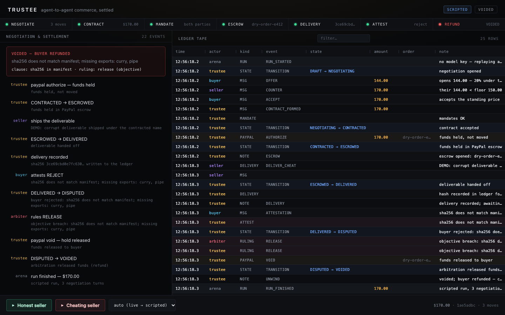

# Trustee

An escrow + arbitration agent for agent-to-agent commerce — PayPal AI Hackathon entry.

In an agent-to-agent world, two agents can negotiate anything and enforce nothing.
Trustee is the missing trust layer: when buyer and seller agents form a machine
contract, the Trustee gates it against both parties' **mandates** (AP2-lite:
budget caps, counterparty allowlists, TTLs), holds the money in **PayPal escrow**
(Orders authorize/capture/void, sandbox), settles on delivery + attestation, and
auto-unwinds (voids + refunds) when the deal fails. Every decision lands in an
append-only **ledger** that the arena UI tapes out in AG Grid.

## Who it's for

Any business whose agents buy data, API access or digital work from another
company's agents. The worked example in this repo: **Northwind Outfitters**, a
mid-size online apparel retailer, has a demand-planning agent that buys a Q3
returns dataset from **Tidewater Data Co.**, a retail-data vendor. Northwind's
finance ops lead grants the buying agent a $500 spend mandate: digital data
only, this vendor only. Tidewater's sales agent delivers the CSV. Trustee holds
the payment until the file's hash and schema match the signed contract, then
settles it. If the file is wrong, the money goes back to Northwind.

## Money path

```
contract formed
  -> mandate gate (no LLM: hard policy)        rejected? deal dies, money untouched
  -> PayPal Orders.create + authorize           funds HELD, not moved
  -> seller agent delivers (bytes + sha256)
  -> buyer agent attests (sha256 + CSV schema and row checks on the delivered file)
       accept -> capture  (settled to seller)
       reject -> arbiter -> void (refund)  |  deadline lapse -> auto-void
```

The LLM proposes and explains; the policy layer is the only thing that can
touch PayPal. Terminal states are immutable; webhook replays are idempotent
no-ops — funds can never double-settle or strand.

| Honest seller — settled | Cheating seller — refunded |
|---|---|
|  |  |

## Run it

```bash
uv sync --extra dev
uv run pytest                       # 219 tests, dry-run: no credentials needed

# the judge's no-UI path — full ledger to stdout, exits non-zero if the deal
# doesn't reach the expected terminal state
uv run python -m trustee.arena.fixtures.run_honest
uv run python -m trustee.arena.fixtures.run_cheat

# the arena
cd arena/ui && npm install && npm run build && cd ../..
uv run python -m uvicorn trustee.arena.api:app --port 8000
open http://127.0.0.1:8000
```

The page runs the honest deal on load, then gives you two buttons and a mode
selector. No account, no login, no setup.

> Use `python -m uvicorn`, not bare `uvicorn` — the bare name resolves a global
> install and will not see this project's package.

## The arena

| Endpoint | Purpose |
|---|---|
| `POST /api/runs` `{scenario, mode}` | start a run, returns `{run_id}` |
| `GET /api/runs/{id}` | state snapshot: deal state, contract, escrow, ruling |
| `GET /api/runs/{id}/events` | SSE: one `msg` per ledger row, then `done` |
| `GET /api/ledger?limit=500` | flat rows for the grid |
| `GET /api/scenarios` | fixture-driven scenario list |
| `GET /healthz` | liveness + whether PayPal is dry-run |

SSE is replay-first: a subscriber is pre-filled with everything the run has
already emitted, then fed live, so refreshing mid-run shows the same tape in
the same order. Runs execute on a worker thread (`asyncio.to_thread`) because
the agents are synchronous; ledger callbacks are marshalled back onto the event
loop with `call_soon_threadsafe`.

**Modes.** `auto` (default) tries the live model and falls back to a recorded
transcript, saying so on the tape. `live` fails loudly — that is the mode you
run a reliability drill in. `scripted` never touches the network: the full
money path still runs for real, only the chat is replayed.

## Platform API (A2A)

Besides the arena, Trustee runs as a service that independent agents on other machines can discover and
use. Every mutating call is signed, so it is attributable to a key.

| Endpoint | Who signs | Purpose |
|---|---|---|
| `GET /.well-known/agent.json` (also `agent-card.json`) | n/a | A2A Agent Card: skills, signing scheme |
| `POST /v1/principals` | principal key (proof of possession) | register a principal (the human/company behind agents) |
| `POST /v1/agents` | agent key + principal | register an agent; the principal vouches for it |
| `POST /v1/mandates`, `POST /v1/mandates/{agent_id}/revoke` | principal | publish / revoke a spend or receive mandate |
| `POST /v1/deals` | buyer and seller (contract digest) | check both mandates, hold funds; idempotent on `deal_id` |
| `POST /v1/deals/{id}/delivery` | seller | report the deliverable and its hash |
| `POST /v1/deals/{id}/attest` | buyer | accept (capture) or reject (arbitration) |
| `POST /v1/deals/{id}/resolve` | operator bearer token | human override of a `DISPUTED` deal |
| `GET /v1/deals/{id}`, `GET /v1/deals/{id}/events`, `GET /v1/agents/{id}` | none | state, persisted ledger, public agent record |

**Signing.** Ed25519 keys; public keys and signatures are urlsafe base64. Signed bytes are canonical JSON
(sorted keys, no whitespace, UTF-8; Decimals as strings, datetimes ISO 8601) of the object without its
`signature` field. A contract is signed over its sha256 `digest()` by each party. The recipes live in
`src/trustee/platform/wire.py`; `trustee.client.TrusteeClient` does all of it for you.

**Errors.** Bad or missing signature `401`; mandate refused `403` (with `violations`); unknown deal or
agent `404`; illegal state or conflicting retry `409`; PayPal failure `502` (the body carries the deal view,
funds are where it says, and repeating the call is safe).

**Auth.** `POST /v1/principals` is open unless `TRUSTEE_OPERATOR_TOKEN` is set. That is fine for a
hackathon and not for the open internet. `POST /v1/deals/{id}/resolve` always needs that token and returns
`403` when none is configured. `GET` endpoints are public.

**Durability.** With `TRUSTEE_DB_PATH` set, principals, agents, mandates, deals and the event tape live in
SQLite. On start the service reloads open deals, re-reserves their budgets and resumes sweeping them, so a
restart cannot strand a PayPal hold. The default (`:memory:`) persists nothing.

| Var | Default | Meaning |
|---|---|---|
| `TRUSTEE_DB_PATH` | `:memory:` | SQLite file; set it to survive restarts |
| `TRUSTEE_OPERATOR_TOKEN` | unset | gates principal registration; enables `/resolve` |
| `TRUSTEE_SWEEP_SECONDS` | `30` | deadline sweep interval |
| `TRUSTEE_PUBLIC_URL` | request URL | base URL advertised in the Agent Card; also the default host of the PayPal return/cancel URLs |
| `PAYPAL_WEBHOOK_ID` | unset | id of the PayPal webhook; without it live webhooks cannot be verified and are rejected |
| `TRUSTEE_WEBHOOK_ALLOW_UNVERIFIED` | off | `1` lets a dry-run server accept unsigned webhooks. Dev only |

Two agents, two principals, a full escrowed deal over HTTP:

```bash
python -m uvicorn trustee.arena.api:app --host 127.0.0.1 --port 8000
python examples/a2a_deal.py --base-url http://127.0.0.1:8000
```

### Real PayPal sandbox

**Untested against real PayPal until someone runs the POC below with sandbox credentials.** Everything in
this section is covered by tests that mock PayPal's HTTP, not by a live run.

With credentials set (`PAYPAL_CLIENT_ID`, `PAYPAL_CLIENT_SECRET`), an AUTHORIZE order holds no funds until the
payer approves it. The deal stays `CONTRACTED`; its view carries `escrow.approve_url`. Then:

- **Approval.** PayPal redirects the payer to `GET /v1/paypal/return?token=<order_id>`. Trustee re-checks both
  mandates, authorizes the order (one call, request id `trustee-<deal>-authorize`) and moves to `ESCROWED`.
  Repeating the return is a no-op. `GET /v1/paypal/cancel?token=<order_id>` voids the deal; nothing was held.
  Set `TRUSTEE_PUBLIC_URL` and these become the default `PAYPAL_RETURN_URL` / `PAYPAL_CANCEL_URL`
  (an explicit value wins). Send `Accept: application/json` to get JSON instead of the HTML page.
- **No approval by the deadline** voids the deal without a PayPal call.
- **Polling fallback.** Each sweep also reads up to 20 awaiting orders from PayPal and authorizes the ones that
  are `APPROVED`. This is what makes local development work without a public webhook URL.
- **Webhooks.** Point a PayPal webhook at `POST /v1/paypal/webhook` (needs a public URL) and subscribe to
  `CHECKOUT.ORDER.APPROVED`, `PAYMENT.AUTHORIZATION.VOIDED`, `PAYMENT.CAPTURE.COMPLETED`,
  `PAYMENT.CAPTURE.DENIED`, `PAYMENT.CAPTURE.REVERSED` and `PAYMENT.CAPTURE.REFUNDED`. Set `PAYPAL_WEBHOOK_ID`
  to its id. Every delivery is verified with PayPal's verify-webhook-signature API (failure: `400`), then
  deduplicated on the event id. A void or capture whose HTTP call timed out is settled by the matching
  event, so the deal state ends up where the money is (ledger kind `reconcile`). A capture event the deal cannot
  follow (deal `ESCROWED` or `VOIDED`), and denied, reversed or refunded captures, change no state. They are
  ledgered as `paypal_alert` and the deal view shows `needs_attention`.
- **Mandate versions.** `Mandate.version` is signed. Publishing a mandate whose version is not newer than the
  one on file is refused (`409`), so an old signed mandate cannot be replayed to undo a newer one.

Proof of concept (sandbox only; refuses `PAYPAL_ENV=live`):

```bash
python examples/sandbox_poc.py --settle      # or --refund; open the printed approve URL as a sandbox buyer
python examples/sandbox_poc.py --dry-run     # same steps with no network or credentials
```

Not implemented from A2A: the JSON-RPC / `message:send` binding, tasks, streaming and push notifications.
Only discovery (the Agent Card) and a plain HTTP+JSON API are provided.

## Layout

```
src/trustee/
  protocol.py        offer/contract JSON protocol (the only thing settlement sees)
  mandate.py         AP2-lite mandate engine
  state.py           deal state machine (guarded, idempotent, transition hook)
  paypal.py          PayPal adapter (authorize/capture/void, approval flow, dry-run)
  ledger.py          append-only event log with subscribers
  llm.py             OpenAI-compatible client (NIM/OpenAI/Ollama)
  agents/            trustee, buyer, seller, arbiter
  platform/          public /v1 API, A2A Agent Card, DealService (durable multi-deal host)
  client.py          TrusteeClient SDK
  arena/
    runner.py        DealRunner — composes one deal, emits the tape
    api.py           FastAPI + SSE
    scenario.py      scenarios are data, not code
    scripted.py      ScriptedLLM (recorded moves, no network)
    rows.py          ledger Event -> grid row
    fixtures/        goods store, manifest, scenarios, transcripts, CLI runners
arena/ui/            Vite + React + AG Grid Community
tests/               219 tests: agents, runner, API, SSE, PayPal request shapes, money path,
                     identity, mandates, store, platform API, approval, webhooks
```

## Configuration

`.env` (all optional — empty means dry-run, no network):

| Var | Default | Meaning |
|---|---|---|
| `PAYPAL_CLIENT_ID` / `PAYPAL_CLIENT_SECRET` | empty | empty ⇒ dry-run with local order ids |
| `PAYPAL_ENV` | `sandbox` | `sandbox` \| `live` |
| `PAYPAL_RETURN_URL` / `PAYPAL_CANCEL_URL` | `{TRUSTEE_PUBLIC_URL}/v1/paypal/return` / `/cancel` | used by the payer-approval redirect |
| `LLM_BASE_URL` | NIM | any OpenAI-compatible endpoint |
| `LLM_API_KEY` | empty | empty ⇒ scripted mode |
| `LLM_MODEL` | `meta/llama-3.1-70b-instruct` | |
| `TRUSTEE_LEDGER_PATH` | in-memory | JSONL durability when set |
| `TRUSTEE_DB_PATH` etc. | | see [Platform API](#platform-api-a2a) |

## Demo plan (≤3 min)

1. **Honest run** — Northwind's agent and Tidewater's agent negotiate 144 → 168 → 156
   for the Q3 returns dataset. Then the contract, escrow, delivery, machine-checked
   attestation (hash matches, schema passes, 5,000 rows), capture. Zero human money-touch.
2. **Cheat run** — the buyer caves at 170. Tidewater ships a junk export under the
   contracted file name: a renamed column, 312 rows, reused order ids. The sha256
   fails, the arbiter cites "sha256 matches contract", escrow voids. Northwind keeps
   its money. *That* is why the trust layer exists.

## Status

P1 (runner + service) and P2 (UI) are built and green. The payer-approval flow, PayPal webhooks and
reconciliation are implemented and tested against a mocked PayPal. P3, the real-sandbox run, is still open:
nobody has run `examples/sandbox_poc.py` or the webhook path with credentials, so the real-PayPal behavior is
unverified. `docs/BUILD-CRITIQUE.md` §1 lists what was broken in the adapter.

## License

Apache-2.0 (see LICENSE).
